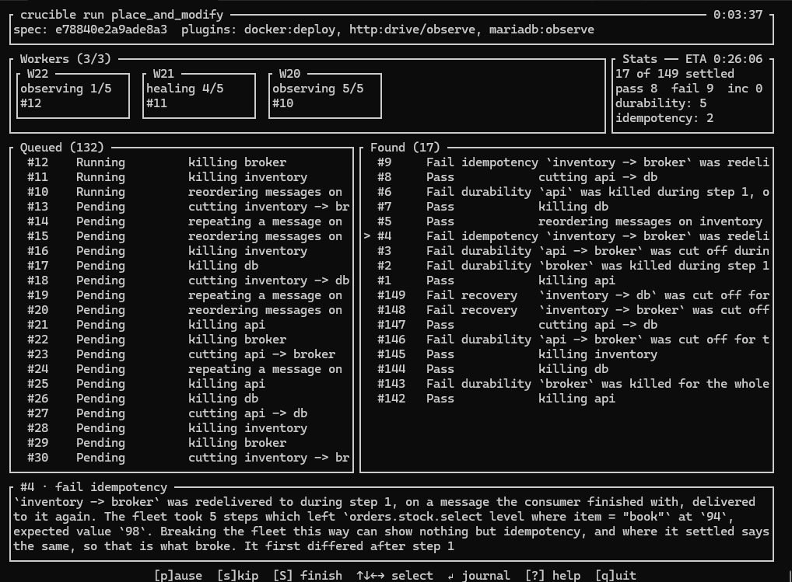

# Crucible

Property-asserted fault injection for event-driven microservices.

MSc Computer Science final project. Stuart Bruce, 2026.

## What Crucible is

Crucible drives an event-driven microservice fleet through deliberate fault
schedules and reports which of four correctness properties no longer hold:
**durability**, **recovery**, **idempotency** and **convergence**. A scenario
author writes what the fleet is and what it should settle at. The framework
works out where a fault can go by watching one fault-free run of the scenario,
places faults at moments a protocol names rather than at byte offsets, and
attributes each failure to a property by where the fleet settled.

No service under test is modified. The fleet runs as its own containers, and a
proxy fronting it reads the wire protocols it knows.

## What you need

- A Rust toolchain from rustup, 1.97 or newer. Built and tested on 1.97.1.
  Debian's packaged `rustc` is older than the dependency set needs.
- Docker, with the daemon running and your user able to reach it. Tested on
  26.1.5. A campaign brings containers up and tears them down, and it leaves
  nothing behind on a clean exit.
- About 1 GB of disk for the example fleet's images, and four cores. A campaign
  runs three replicas of the fleet at once, which `CRUCIBLE_CONCURRENCY` sets.

## Build

Three steps: the framework, the proxy image, and the example fleet's images.

```
cargo build --release
crucible-proxy/build.sh
examples/orders/1_base/build.sh
```

`cargo build` produces `target/release/crucible` and the worker beside it. The
runner looks for the worker next to itself, so run the binary from
`target/release` rather than copying it elsewhere.

## Run

Check a scenario file without running anything. This is instant and needs no
Docker:

```
./target/release/crucible check examples/orders/1_base/orders.cru
```

`examples/errors/errors.cru` is a deliberately broken fleet carrying one of
every diagnostic, if you want to see what a rejection looks like.

Then run a campaign:

```
./target/release/crucible run examples/orders/1_base/orders.cru
```

This fits 149 schedules and takes about 24 minutes on four cores. Press `S` at
any point to stop scheduling and report on what it has, which is enough to see
the framework work in two or three minutes.

The screen shows the schedules queued, the verdicts found so far, and the
selected verdict in full. `↑↓←→` moves between the two lists, `↵` opens the
journal for the selected schedule, `p` pauses, `s` skips the selected schedule,
`?` lists the keys and `q` quits. When the campaign is over the footer names
the report and `o` opens it.



`--debug` streams the diagnostic log instead of drawing the screen.

## Where the output goes

Each run writes to `~/.local/state/crucible/logs/<pid>/`:

| | |
| --- | --- |
| `<date>-<spec hash>-report.md` | every schedule, grouped by what it returned |
| `journal.ndjson` | every event the run produced |
| `run.log` | the diagnostic log |

`--report <path>` writes the report somewhere else instead.

## The example fleets

`examples/orders` is one fleet written eight times. `1_base` is an
event-driven fleet written without accounting for what a distributed system
does, and each directory after it fixes the fault the one before it left, by
the textbook remedy for that fault. `diff -r 1_base 2_outbox` is the change
itself. Each has its own `build.sh`, and `examples/orders/README.md` works
through the sequence.

`examples/pdns` is a second fleet around an off-the-shelf nameserver. Its
scenario reads what the nameserver answers, which needs a plugin that is not a
built-in, so it takes two more steps:

```
examples/pdns/build.sh
cargo build --release --manifest-path examples/dns-observer/Cargo.toml
mkdir -p ~/.local/share/crucible/plugins
cp examples/dns-observer/target/release/crucible-observer-dns \
   ~/.local/share/crucible/plugins/
./target/release/crucible run examples/pdns/pdns.cru
```

A plugin is an executable under `~/.local/share/crucible/plugins` or
`/usr/lib/crucible/plugins`. The framework asks each one what its capabilities
are. `examples/dns-observer` is its own workspace and only depends on
`crucible-plugin`, which is an example of how a third party plugin would be
authored.

## Architecture

```
  +- runner --------------------------------------------------------+
  |  L3 scheduler            L5 reporter                            |
  |  budgets the schedules   journal, verdicts, report              |
  +-------+--------------------------+---------------------+--------+
          | a unix socket each       |                     |
  +-------v---------+     +----------v------+     +--------v--------+
  | worker 1        |     | worker 2        |     | worker N        |
  | L2 discovery    |     |                 |     |                 |
  | L4 orchestrator |     |       ...       |     |       ...       |
  +-------+---------+     +-----------------+     +-----------------+
          | one fleet replica each
  +-------v---------------------------------------------------------+
  |  replica                                                        |
  |                                                                 |
  |             +------------- L1 proxy ------------+               |
  |  driver --> |  a listener per port, two planes  | --> api, db   |
  |             +-----------------+-----------------+               |
  |  the worker reads state ------+                                 |
  |  on the control plane                                           |
  +-----------------------------------------------------------------+
```

One proxy container fronts every service that listens, binding a listener per
port on each of two planes. The **data plane** carries what the scenario drives
and is what a fault acts on. The **control plane** is a side channel the
framework reads state through, so its own observations never count as the
fleet's traffic. Above the proxy:

- **Kind plugins** read a wire protocol so the proxy can act on whole logical
  operations rather than raw bytes, and name the moments a fault can be placed
  at. AMQP 0-9-1 and the MySQL client/server protocol ship.
- **The deployment plugin** brings the fleet up, tears it down, and places the
  faults that are not in the byte stream. The one that ships is container
  shaped.
- **Driver and observer plugins** drive the scenario's steps and read the state
  it expects to settle at. HTTP does both; MariaDB observes.
- **The span tier** reaches moments inside a service that a proxy cannot see, a
  publish formed but not yet on the wire among them, through a per-language
  tracing adapter.

A worker owns an isolated replica of the fleet, so schedules run in parallel
without interfering with each other.

## Layout

| crate | |
| --- | --- |
| `crucible` | the runner and the worker, and the command line |
| `crucible-core` | the types the components share |
| `crucible-dsl` | the `.cru` front end: lexer, parser, diagnostics |
| `crucible-engine` | the run loop, the scheduler and the verdict |
| `crucible-plugin` | the plugin contract, and the plugins that ship |
| `crucible-kind` | the kind plugins compiled into this build |
| `crucible-kind-amqp` | what the framework understands of AMQP 0-9-1 |
| `crucible-kind-mariadb` | the same for the MySQL client/server protocol |
| `crucible-protocol` | the wire types the components speak between themselves |
| `crucible-proxy` | the proxy that fronts the fleet |
| `crucible-span-rust` | the Rust tracing adapter for the span tier |

## Tests

```
cargo test --all-features
```

Two tests need a Docker daemon and are skipped without one, and two are
illustrative examples that never run.
